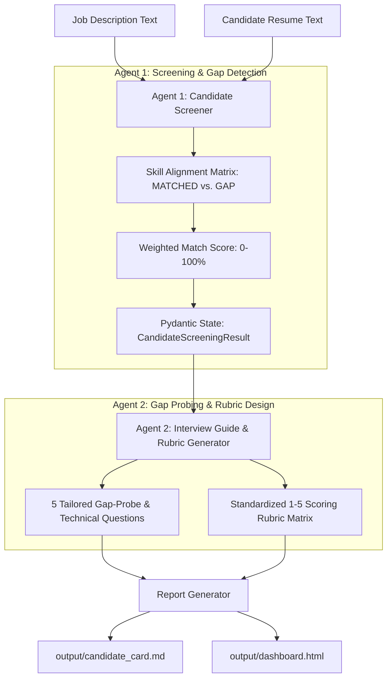

# 🎯 TalentPilot — Recruiter Intake & Evaluation Playbook
PLAYBOOK.md — Multi-Agent Candidate Screening & Rubric SOP

This playbook defines standard operating procedures, 2-agent sequential handoffs, screening score calibration, gap-targeted question design, and grading rubric governance for **TalentPilot**.

---

## 1. 💼 Executive Overview & Business Case

### The Problem
Recruiters and hiring managers waste **20+ hours per open headcount** sifting through resumes, asking generic interview questions (*"Tell me about a time you failed"*), and relying on subjective gut feel. Candidates slip through or get rejected without standardized qualification scoring.

### The Automated Solution
A 2-agent sequential system that pairs **Candidate Screening** with **Tailored Interview Rubric Generation**:
* **Agent 1 (Screener)**: Cross-references resume bullet points against job description requirements, calculates weighted alignment, and identifies specific skill gaps.
* **Agent 2 (Rubric Generator)**: Consumes Agent 1's exact state object to formulate 5 high-leverage technical probe questions with expected strong answer criteria and a 1–5 scoring rubric.

### Quantified ROI & Value
* **Screening Speed**: Reduces resume intake and rubric generation from **45 minutes to < 3 seconds**.
* **Interview Precision**: Replaces generic interview questions with gap-targeted probes that test actual missing competencies.
* **Standardized Evaluation**: Enforces consistent 1–5 grading matrices across all candidate interviews to eliminate hiring bias.

---

## 2. 🏗️ System Architecture & Multi-Agent Flow

---

## 3. 📋 Standard Operating Procedures (SOP)

### SOP-01: Candidate Screening & Match Calibration
1. **Intake**: Job Description (JD) and Resume text files are fed into the pipeline.
2. **Match Score Calculation**:
   $$\text{Match Score} = \left( \frac{\sum \text{Matched Required Skills}}{\text{Total Required Skills}} \right) \times 100$$
3. **Verdict Tiering**:
   * 🟢 **Strong Match ($\ge 80\%$)**: Advances directly to hiring manager screen.
   * 🟡 **Moderate Match ($60\% - 79\%$)**: Advances to phone screen with gap probes.
   * 🔴 **Low Match ($< 60\%$)**: Flagged for recruiter review or polite decline.

### SOP-02: Gap-Probe Question Formulation
For every qualification marked `GAP` by Agent 1, Agent 2 must generate:
* **The Specific Question**: Inquiring about transferable experience or domain adaptability.
* **Targeted Competency**: Explicitly named skill being evaluated.
* **Ideal Strong Answer**: What a top-performing candidate must demonstrate.

### SOP-03: Standardized 1–5 Scoring Rubric Enforcement
Interviews are graded across 3 core pillars:
* **Level 1 (Poor)**: Lacks foundational knowledge, relies on buzzwords.
* **Level 3 (Proficient)**: Competent, demonstrates hands-on implementation experience.
* **Level 5 (Expert)**: Architectural mastery, handles edge cases, teaches best practices.

---

## 4. 🛡️ Guardrails, Security & Anti-Bias Standards

* **Strict Pydantic Enforcer**: Guarantees all outputs adhere to `CandidateScreeningResult`, `TailoredQuestion`, and `RubricCriterion` schemas.
* **Anti-Bias Masking**: Screening evaluates skills, tools, methodologies, and accomplishments—filtering out age, gender, and personal identifiers.
* **Dual-Engine Execution**: Seamlessly operates in live Claude AI mode or zero-config offline mode for CI/CD test pipelines.

---

## 5. 🚨 Recruiter Exception Handling & Escalation

| Scenario | System Output | Recruiter Action |
| :--- | :--- | :--- |
| **High Match (>90%) but Missing Domain Standard** | Question #1 generated specifically as Domain Gap Probe | Recruiter uses Question #1 to test candidate ramp-up speed. |
| **Non-Standard Resume Layout** | Heuristic fallback identifies key project metrics | Recruiter verifies contact information during intake. |
| **Borderline Score (70-75%)** | Highlights strengths in blue and gaps in amber | Hiring manager reviews rubric before scheduling loop. |

---

## 6. 🚀 Deployment & Operational Checklist

- [ ] **Dependencies**: `pip install -r requirements.txt` (pydantic, pytest, anthropic, python-dotenv).
- [ ] **Environment**: Set `ANTHROPIC_API_KEY` in `.env` (or run in offline demo mode).
- [ ] **Multi-Role Testing**: Run across pre-loaded roles:
  * `py app.py --sample engineer` (AI Software Engineer)
  * `py app.py --sample pm` (AI Product Manager)
  * `py app.py --sample analyst` (Healthcare Data Analyst)
- [ ] **Automated Testing**: `pytest tests/` (verify 100% test pass rate).

---

## 7. 💬 Stakeholder FAQ

**Q: Why use two agents instead of one prompt?**  
*A: Single-prompt models suffer when trying to simultaneously score a resume, extract gaps, design interview questions, and write a grading rubric. The 2-agent sequential handoff ensures each agent focuses on one high-precision task.*

**Q: Can this be customized for non-technical roles?**  
*A: Yes. The system automatically adapts its skill matching and question generation to any job description (Product Management, Analytics, Sales, Operations, Healthcare).*
